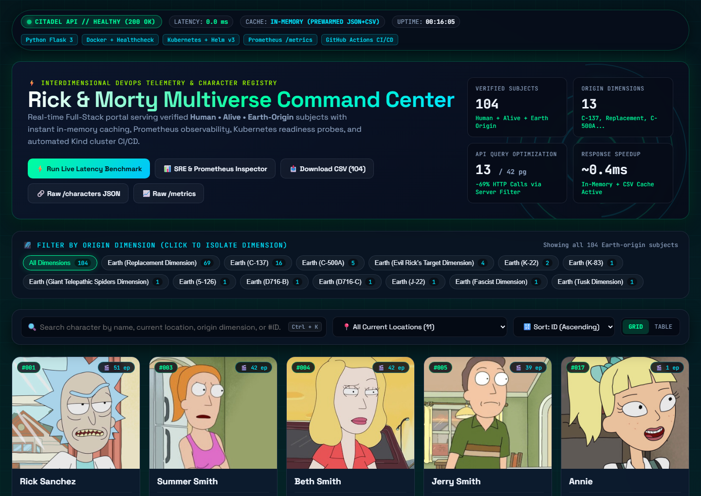
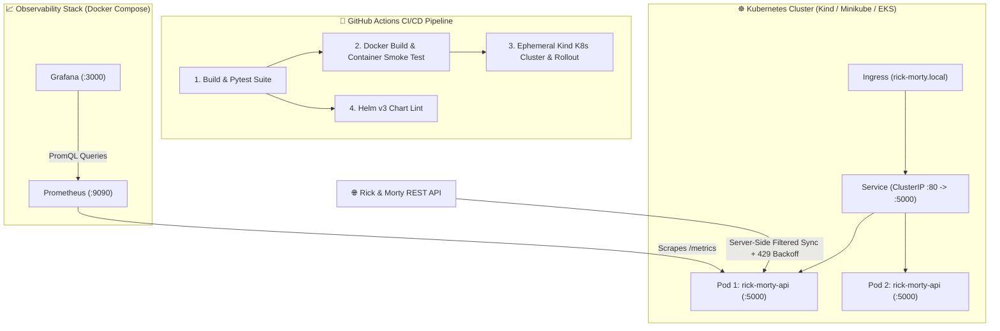

# 🧪 Rick and Morty Multiverse DevOps Platform


End-to-end **Full-Stack DevOps & SRE Platform** built around the Rick and Morty REST API — featuring a sub-millisecond cached Flask backend, an interactive **Citadel Multiverse Command Center UI**, automated **Pytest** validation, **Docker** containerization, **Kubernetes & Helm v3** manifests, **GitHub Actions CI/CD** with ephemeral **Kind** cluster verification, and a full **Prometheus + Grafana** observability stack.

---

## 🖥️ Full-Stack Citadel Command Center UI (`GET /`)



### Key Full-Stack Capabilities
- **⚡ Sub-Millisecond In-Memory + CSV Cache**: Pre-warmed character cache (`~0.2 ms` response latency vs `~12,000 ms` uncached pagination) with automatic upstream `HTTP 429` `Retry-After` handling and server-side query filtering (`?species=Human&status=Alive`, reducing upstream scan from 42 pages to 13 pages).
- **📊 Live SRE & Prometheus Telemetry Drawer**: Built-in real-time inspection of `/healthcheck`, `/api/stats`, and raw `/metrics` streams directly from the browser.
- **🌌 Interactive Multiverse Filtering**: One-click filtering by **Origin Dimension** (`Earth (C-137)`, `Earth (Replacement Dimension)`, `Earth (C-500A)`, etc.), **Current Location**, instant search (`Ctrl + K`), sorting by episode count, and `Grid` / `Table` view switching.
- **🗂️ Subject Intelligence Dossier Modal**: Clicking any character card opens a top-layer animated `<dialog closedby="any">` dossier with full metadata, JSON payload inspector, and a one-click `curl | jq` command generator.

---

## 🏗️ System & Observability Architecture



---

## 📁 Project Structure

```text
.
├── app/
│   ├── api.py                   # Full-Stack Flask REST API + In-Memory Cache + Prometheus Metrics
│   ├── main.py                  # CLI Character Fetcher & CSV Generator (with 429 backoff)
│   ├── characters_cache.json    # Pre-warmed enriched dataset cache (104 Earth-origin Humans)
│   ├── requirements.txt         # Python dependencies
│   └── templates/
│       └── index.html           # Citadel of Ricks Full-Stack Command Center UI
├── tests/
│   └── test_api.py              # Automated Pytest suite (API, cache, CSV export & UI)
├── yamls/                       # Raw Kubernetes Manifests
│   ├── deployment.yaml          # Deployment (Replicas, Liveness/Readiness Probes, Resources)
│   ├── service.yaml             # ClusterIP Service
│   └── ingress.yaml             # Ingress routing
├── helm/
│   └── rick-morty-api/          # Helm v3 Chart
│       ├── Chart.yaml
│       ├── values.yaml
│       └── templates/
│           ├── deployment.yaml
│           ├── service.yaml
│           └── ingress.yaml
├── monitoring/                  # Observability Stack
│   ├── prometheus/
│   │   ├── prometheus.yml       # Scrape configuration
│   │   └── alerts.yml           # Prometheus alerting rules
│   └── grafana/
│       └── provisioning/        # Automated Datasource & Dashboard provisioning
├── screenshots/
│   ├── citadel-command-center.png
│   └── grafana-dashboard.png
├── .github/workflows/
│   └── ci-cd.yaml               # Multi-stage GitHub Actions CI/CD workflow
├── docker-compose.yaml          # Full stack (App + Prometheus + Grafana)
├── Dockerfile                   # Production container definition with HEALTHCHECK
└── README.md
```

---

## 🚀 Quick Start

### 1. Run Locally (Python)

```bash
pip install -r app/requirements.txt pytest

# Run automated unit tests
pytest -v

# Run CLI CSV generator
python app/main.py

# Start Full-Stack Server on http://localhost:5000
python app/api.py
```

### 2. Run with Docker

```bash
docker build -t rick-morty-api:latest .
docker run -d -p 5000:5000 --name rick-morty-api rick-morty-api:latest
```

### 3. Run Full Monitoring Stack (App + Prometheus + Grafana)

```bash
docker-compose up -d --build
```

| Service | URL | Credentials |
|---------|-----|-------------|
| **Citadel Command Center UI** | `http://localhost:5000` | — |
| **Prometheus UI** | `http://localhost:9090` | — |
| **Grafana Dashboard** | `http://localhost:3000` | `admin` / `admin` |

---

## 🔌 REST API Endpoints

| Endpoint | Method | Description |
|----------|--------|-------------|
| `/` | `GET` | **Full-Stack Citadel Command Center UI** (or JSON docs with `?format=json`) |
| `/characters` | `GET` | Returns all verified `Human` + `Alive` + `Earth`-origin characters as JSON |
| `/api/stats` | `GET` | Real-time SRE telemetry, cache latency (`ms`), uptime, and dimension breakdown |
| `/api/export.csv` | `GET` | Direct downloadable `CSV` export (`Name,Location,Image`) |
| `/healthcheck` | `GET` | Kubernetes Liveness & Readiness health probe (`{"status": "healthy"}`) |
| `/health` | `GET` | Health check alias |
| `/metrics` | `GET` | Prometheus metrics exporter stream |

### Sample Response (`GET /characters`)

```json
{
  "count": 104,
  "characters": [
    {
      "id": 1,
      "Name": "Rick Sanchez",
      "Location": "Citadel of Ricks",
      "Image": "https://rickandmortyapi.com/api/character/avatar/1.jpeg",
      "origin": "Earth (C-137)",
      "episodes": 51
    }
  ]
}
```

---

## ☸️ Kubernetes & Helm Deployment

### Option A: Raw Kubernetes Manifests (`yamls/`)

```bash
kubectl apply -f yamls/deployment.yaml
kubectl apply -f yamls/service.yaml
kubectl apply -f yamls/ingress.yaml

kubectl wait --for=condition=available --timeout=120s deployment/rick-morty-api
kubectl port-forward service/rick-morty-api-service 8080:80
```

### Option B: Helm v3 Chart (`helm/rick-morty-api`)

```bash
# Lint the chart
helm lint ./helm/rick-morty-api

# Install or upgrade release
helm upgrade --install rick-morty ./helm/rick-morty-api \
  --set replicaCount=2 \
  --set image.tag=latest
```

---

## 📊 Grafana & Prometheus Monitoring


### Custom Metrics & Alert Rules (`monitoring/prometheus/alerts.yml`)
- **`api_request_latency_seconds`**: Request latency histogram across endpoints.
- **`flask_http_request_total`**: Request rate and HTTP status code distribution.
- **Configured Alerts**: `APIDown`, `HighResponseTime`, `HighErrorRate`, `PodRestartingFrequently`, and `HighMemoryUsage`.
